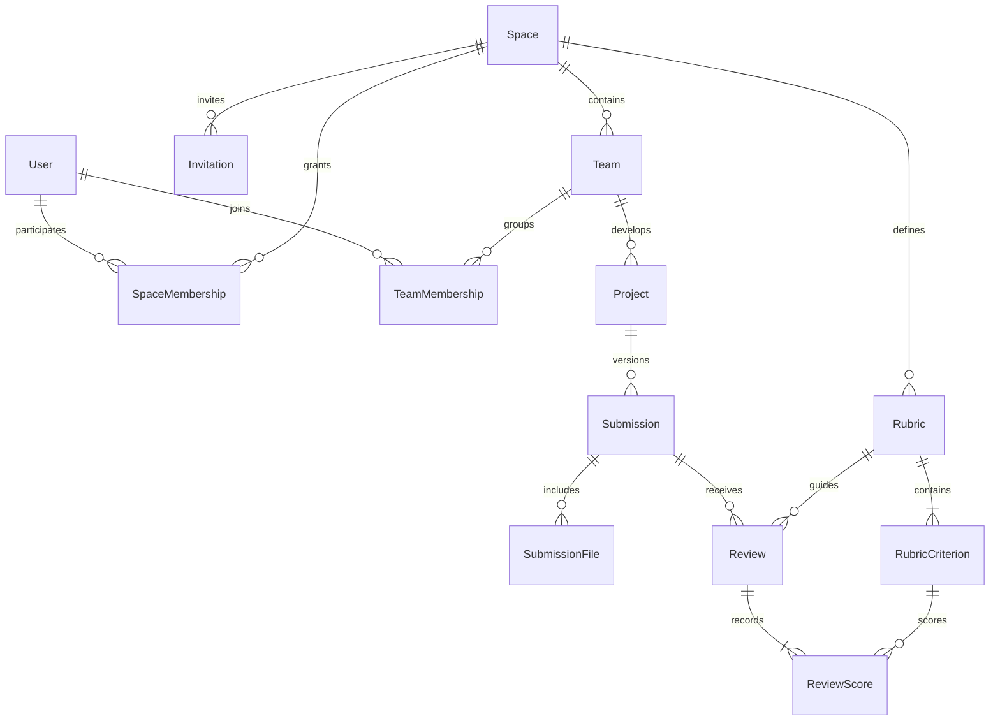

# Model de dades proposat — Campus

Aquest és el model objectiu del backend compartit. La primera implementació i migració són a `apps/api`; encara no s’han desplegat al núvol. El prototip utilitza les estructures simplificades de `apps/web/lib/model.ts`.

| Entitat | Camps principals | Relacions i restriccions |
| --- | --- | --- |
| User | id, auth_subject, display_name, email_verified | Identitat externa única; sense contrasenyes a les taules de projecte |
| Space | id, title, subject, created_by, due_at, timezone | El creador rep membresia docent en la mateixa transacció |
| SpaceMembership | space_id, user_id, role, status | Única per espai/usuari; teacher o student. El rol és per espai, no global |
| Invitation | id, space_id, token_hash, expires_at, invited_email, accepted_by | Token d’un sol ús; l’acceptació crea la membresia, mai el coneixement de l’ID d’espai |
| Team | id, space_id, name | Un equip pertany a un espai |
| TeamMembership | team_id, user_id, joined_at | Usuari amb membresia activa a l’espai; membres únics |
| Project | id, team_id, title, description, category, created_at | Privat per defecte; cap publicació automàtica |
| Submission | id, project_id, version_number, note, submitted_by, submitted_at | Número únic i creixent per projecte, assignat pel servidor; contingut tancat després de presentar-lo |
| SubmissionFile | id, submission_id, storage_key, original_name, size, media_type, scan_status | Blob privat amb clau generada al servidor; no executar ni servir HTML pujat com a pàgina |
| Rubric | id, space_id, version, title | Versions preservades quan ja s’han utilitzat |
| RubricCriterion | id, rubric_id, label, weight, position | Pesos sumen 100; l’ordre no canvia a posteriori en una rúbrica publicada |
| Review | id, submission_id, rubric_id, reviewer_id, feedback, published_at | Només docent de l’espai; la puntuació no s’accepta sense criteris vàlids |
| ReviewScore | review_id, criterion_id, score | Criteri de la rúbrica seleccionada; entre 0 i 10; total calculat al servidor |
| AuditEvent | actor_id, space_id, entity_id, action, occurred_at | Registre d’accions sense copiar el contingut de documents ni tokens |

## Autorització prevista

| Acció | Professor de l’espai | Alumne de l’equip | Altres usuaris |
| --- | --- | --- | --- |
| Configurar espai i rúbrica | Sí | No | No |
| Veure projectes i entregues | Sí, dins del seu espai | Només del seu equip | No |
| Crear projecte i presentar versió | No en nom d’un alumne | Sí | No |
| Descarregar document | Sí, dins del seu espai | Sí, del seu projecte | No |
| Publicar feedback i avaluació | Sí | No | No |
| Llegir feedback publicat | Sí | Sí, del seu projecte | No |

Cada consulta, descàrrega i mutació haurà de verificar aquestes relacions al servidor; ocultar botons al frontend no dona aquesta garantia. Els IDs proporcionats pel client no determinen l’espai o propietari autoritzat. La nota final es deriva dels criteris i pesos de la rúbrica històrica, no d’un total calculat pel navegador.

## Publicació i IA: fora del primer backend

No es crearà cap còpia pública d’un treball en presentar-lo ni en rebre una bona puntuació. L’aparador requerirà un flux específic d’autoritzacions i retirada. L’ús d’un assistent sobre documents haurà de limitar-se al projecte autoritzat; l’ús per entrenament s’ha de tractar separadament. Els noms dels membres registren participació, sense determinar automàticament la titularitat legal del treball.

## Primera implementació disponible

`apps/api` implementa usuaris provisionats des d’OIDC, espais, membresies, equips, invitacions d’un sol ús, projectes privats, entregues textuals versionades, revisions amb snapshot de rúbrica i auditoria d’accions. La rúbrica inicial és fixa i la revisió publicada és immutable. `SubmissionFile`, rúbriques configurables i el flux de correcció d’avaluacions resten pendents. Consulta el README de l’API per a les operacions, proves i límits exactes.
