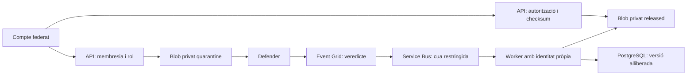

# Documents privats: càrrega, anàlisi i descàrrega

## Increment implementat, encara sense desplegar

L’API i el consumidor utilitzen Azure Blob, Managed Identity i Service Bus. La migració `0004` afegeix documents i rebuts d’anàlisi amb RLS forçada a PostgreSQL. El consumidor és un procés separat, sense endpoint HTTP per acceptar veredictes de participants.

`DOCUMENTS_ENABLED=false` és el valor per defecte. No s’han activat càrregues reals ni creat serveis Azure amb aquest canvi. Les proves de negoci utilitzen un emmagatzematge de proves explícit; el servidor no té fallback de disc/memòria ni de claus compartides.



## API de documents

Les rutes són de vaults privats, no d’entregues acadèmiques. Encara no s’han exposat al proxy Campus ni s’ha creat una pantalla de pujada.

| Ruta | Comportament |
| --- | --- |
| `POST /v1/vaults/{vault_id}/documents` | Només owner/contributor. Cos binari, Content-Type application/pdf o text/plain i X-File-Name codificat amb percent-encoding UTF-8. Màxim 10 MiB. Respon amb metadades i estat quarantined |
| `GET /v1/vaults/{vault_id}/documents` | Membres actuals del vault; limit 1–100, offset 0–100000 |
| `GET /v1/vaults/{vault_id}/documents/{id}/content` | Membres actuals; només estat released, versió i ETag fixats, mida i SHA-256 comprovats |

El servidor genera la clau `vault-UUID/document-UUID`; el nom original no forma part de la ruta de Blob. Les respostes no exposen ETags, versions, checksums ni URLs de Storage. Els noms rebutgen separadors i controls. La validació inicial comprova marca PDF o text UTF-8 sense controls binaris; no és un parser complet ni substitueix l’antimalware.

Abans de pujar es desa una intenció uploading. Si l’upload falla, queda failed. Només es marca quarantined quan Storage retorna ETag i versió. Un error de DB posterior pot deixar un blob orfe privat o una intenció uploading, però no l’allibera. El circuit de neteja d’orfes resta pendent.

La descàrrega retorna attachment/application/octet-stream, no-store i nosniff. Es comprova el SHA-256 del contingut descarregat contra el registrat en pujar, abans d’enviar cap byte. Un estat pendent/bloquejat retorna 423; un document d’un altre vault retorna 404. La revocació s’aplica a la següent petició; no pot retirar còpies descarregades ni interrompre totes les peticions ja autoritzades.

Es registren càrregues i descàrregues amb actor, vault i document ID, sense contingut, nom original ni tokens a l’auditoria. Les respostes autenticades no es cachegen. El límit de 10 MiB és per petició: no substitueix quotes totals ni rate limiting.

## Resultat de l’escàner

El worker només consumeix la cua configurada amb ManagedIdentityCredential. **La confiança depèn que només la identitat de lliurament Event Grid autoritzada pugui enviar-hi missatges.** No es confia en tags editables, un camp scan_status ni un veredicte aportat pel navegador. El compte tècnic de l’escàner és privilegiat per aquesta operació i no s’ha de compartir amb participants.

S’accepta EventGridSchema, un event per missatge, màxim 64 KiB, amb:

- Topic ID configurat i eventType Microsoft.Security.MalwareScanningResult.
- blobUri del compte HTTPS exacte, contenidor quarantine o released i clau canònica del document, sense query/SAS.
- eTag coincident amb la càrrega o còpia registrada, segons el contenidor. La lectura fixa també el version_id corresponent. Només un resultat net de quarantine pot alliberar; un resultat de released mai inicia promoció.
- Només No threats found pot iniciar promoció; Malicious, Error i Not scanned bloquegen. Veredictes desconeguts o sobres malformats no alliberen res i van a dead-letter.

La promoció llegeix la versió exacta en quarantena, comprova mida/checksum i crea la còpia released sense overwrite. En reintentar, una destinació existent només s’accepta després de tornar a comprovar els seus bytes i fixar-ne la versió. No s’utilitzen còpies asíncrones pendents ni URLs signades.

Un lock de fila serialitza els veredictes d’un document. ID d’event i hash canònic detecten duplicats i ID reutilitzat amb dades diferents. El rebut i l’estat es confirmen en la mateixa transacció. Si Storage o DB fallen, el missatge es reintenta; una còpia orfe no és suficient per descarregar. Un resultat net després de blocked no torna a alliberar el document. Un resultat maliciós posterior a released, sobre la càrrega o la còpia exacta, el bloqueja per a les peticions següents. La còpia també pot generar escaneig i cost addicionals; el filtre Event Grid limita els URI al compte i als dos contenidors.

Els resultats prematurs, encara amb uploading, es reintenten. La cua limita a deu lliuraments i té dead-letter; cal monitorar la DLQ i els errors de lliurament d’Event Grid. El worker renova el lock de missatge durant el processament. Un pressupost d’escaneig exhaurit o una caiguda del servei deixa documents sense alliberar.

## SQL: dues identitats tècniques

La migració requereix un administrador amb CREATEROLE i reserva dos grups NOLOGIN, sense superusuari/BYPASSRLS:

- `incfs_documents_api`: SELECT/INSERT de documents i UPDATE limitat a status/source_etag/source_version. RLS restringeix la lectura al projecte, l’alta a un writer i l’actualització uploading → quarantined/failed. No pot publicar released ni escriure rebuts d’escàner.
- `incfs_scanner`: SELECT de metadades de documents/rebuts, INSERT de rebuts i UPDATE només de status/released_etag/released_version. Pot processar documents de tots els vaults, però no llegir identitats ni membresies i no té BYPASSRLS. Els rebuts són el seu registre tècnic d’accions.

Les polítiques d’usuaris de documents s’apliquen només al primer grup; les de servei, només al segon. L’API en producció rebutja el grup scanner; el worker rebutja rols administratius, propietaris o membres de documents_api. RLS de les cinc taules ha d’estar forçada.

Per una instal·lació nova, usar `apps/api/scripts/runtime-role.sql` després d’Alembic. Per una instal·lació que ja té incfs_api, l’administrador ha d’afegir:

```sql
GRANT incfs_documents_api TO incfs_api WITH INHERIT TRUE;
GRANT incfs_scanner TO "login-separat-del-worker" WITH INHERIT TRUE;
```

Aquests GRANT utilitzen PostgreSQL 16 i fan explícita l’herència; l’arrencada comprova que els permisos siguin efectivament actius, no només que hi hagi pertinença al grup. Els logins, secrets de DB i membresies es provisionen fora del codi. El rol worker no té permís per modificar l’esquema ni transferir propietat. Un administrador o un worker compromès continua sent una amenaça privilegiada: RLS no és una defensa contra tots els administradors del sistema. Els grups NOLOGIN es conserven en downgrade perquè poden tenir logins associats.

## Configuració i Azure

API: `DOCUMENTS_ENABLED`, `BLOB_ACCOUNT_URL`, `BLOB_UPLOAD_CLIENT_ID`, `BLOB_READER_CLIENT_ID`, més OIDC i PostgreSQL de producció. Les identitats Blob han de ser diferents. No s’utilitza Azure CLI ni cap storage key com a fallback.

Worker: `.env.scanner.example` documenta SCANNER_DATABASE_URL, BLOB_ACCOUNT_URL, SCANNER_CLIENT_ID, SCANNER_SERVICE_BUS_NAMESPACE, SCANNER_SERVICE_BUS_QUEUE i SCANNER_EVENT_GRID_TOPIC_ID. Arrencada amb configuració protegida:

```bash
cd apps/api
uv run --env-file .env.scanner python -m campus_api.scan_worker
```

SCANNER_CLIENT_ID és el client ID de la identitat de promoció/recepció; els inputs Terraform principal_id són els object IDs corresponents. No són intercanviables. Guardar credencials SQL en configuració protegida/Key Vault, mai en Git.

El mòdul Terraform independent afegeix cua Service Bus, RBAC sender/receiver i subscripció Event Grid. Requereix un namespace existent amb xarxa privada/Private Endpoint, autenticació local desactivada i bypass de serveis Microsoft de confiança adequat. El worker consumeix des de la xarxa privada.

**Excepció de xarxa documentada per Microsoft:** el topic custom de resultats de Defender ha d’admetre public IP access i estar a la mateixa regió que Storage. L’Event Grid basic delivery usa endpoints públics autenticats; no es presenta com un trajecte Private Link de punta a punta. La subscripció usa la identitat **system-assigned del topic**, necessària quan el namespace té firewall. Restringir els publishers al servei Defender i desactivar autenticació local del topic quan sigui compatible amb la integració verificada. Els missatges contenen identificadors/URI opacs i resultat, no el cos ni el nom original del document.

Fonts: [Defender Event Grid configuration](https://learn.microsoft.com/en-us/azure/defender-for-cloud/advanced-configurations-for-malware-scanning#set-up-event-grid-for-malware-scanning), [scan results and network limitations](https://learn.microsoft.com/en-us/azure/defender-for-cloud/defender-for-storage-malware-scan), [Event Grid identity and firewall rules](https://learn.microsoft.com/en-us/azure/event-grid/deliver-events-using-managed-identity#firewall-and-virtual-network-rules).

## Verificació i límits abans d’activar

Proves SQLite/PostgreSQL: estats, variants de veredicte, subjecte/ETag/compte incorrectes, duplicats/conflictes, checksums, fallades d’upload, versions, revocació i permisos de dos logins SQL limitats. Les proves de l’adaptador comproven els arguments de versió/If-Match de l’SDK Azure. Els tests Terraform són mocks; les proves d’Storage són dobles de prova, no una anàlisi real de Microsoft Defender.

Encara cal validar a Azure identitats, xarxa, topic/queue trust, esquema natiu de l’event, escaneig net/infectat/no analitzable i recuperació/DLQ. Abans del pilot: MFA/step-up i federació real, quotes/rate limiting, neteja d’orfes, política de retenció/supressió de versions/backups, alertes operatives i revisió del conjunt. No hi ha pantalla d’upload ni desplegament actiu en aquest increment.

## Increment posterior: portal i accés reforçat

La interfície `/private`, el BFF de fitxers i la comprovació del context d’autenticació ja estan implementats. La prova real de prerequisits Azure ha retornat blocked perquè encara falten els serveis desplegats i la verificació de política. Consulteu [el resultat i els passos de validació](private-pilot-validation.md).
