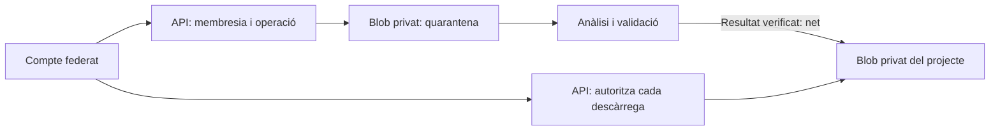

# Startups: espais privats i federació

## Frontera d’accés

Cada projecte privat és una frontera independent (`ProjectVault`). Una startup amb dos projectes tindrà dos espais; ser propietari d’un no dona accés a l’altre. Campus conserva les seves regles docents i no crea membresies privades. La fitxa pública de BeFirst continua separada i no s’importa.

La passarel·la combina verificació d’identitat, autorització del recurs i control d’emmagatzematge. Una xarxa privada o un prefix de carpeta no substitueixen aquests controls. L’objectiu és reduir i detectar vies de filtració amb barreres comprovables; no es promet absència absoluta de filtracions.

## Disponible en aquest increment

- `/v1/vaults`: crear i llistar només els projectes amb membresia; consultar-ne el nom i el rol propi.
- El creador rep `owner`. Pot concedir accés a un compte existent com a `reader` o `contributor`, i revocar-lo. Aquests dos rols només poden consultar la fitxa en aquesta fase: encara no hi ha operacions sobre documents.
- Gestió de membres i consulta d’esdeveniments exclusives del propietari. No es pot concedir owner ni eliminar-lo; la transferència i recuperació administrativa resten pendents.
- Sense herència de permisos per correu, domini, institució, rol docent o propietat d’un altre projecte.
- Sense membresia, consulta i gestió retornen el mateix 404 que un projecte inexistent. El llistat filtra abans de paginar. Les respostes `/v1/` porten `Cache-Control: no-store`.
- Registre transaccional de creació, concessió i revocació sense contingut ni tokens. És un registre a la base de dades, encara no un arxiu immutable contra administradors.

És una base de backend: encara no hi ha interfície d’incorporació de startups, verificació legal d’empreses, invitacions de vault ni càrrega de fitxers. No s’amplia el proxy Campus per exposar aquestes rutes al navegador.

## Incorporació prevista

1. El promotor s’identifica amb un compte personal federat i crea l’espai. La representació legal de l’empresa no es dedueix del login.
2. Informa del projecte sense aportar encara documentació sensible.
3. A la futura interfície, el participant sol·licita accés i el propietari confirma compte i rol. No hi ha incorporació automàtica per domini.
4. La concessió actual via API utilitza el `user_id` intern obtingut pel destinatari a `/v1/me`, verificat pel propietari per un canal conegut. No hi ha cercador global d’usuaris ni concessió per email. És un mecanisme de desenvolupament, pendent de sol·licitud/acceptació per al pilot.
5. La baixa elimina la membresia: la següent petició la torna a comprovar encara que la sessió OIDC segueixi vigent. Una petició ja autoritzada en curs pot acabar; no es pot retirar una còpia ja descarregada.

## Federació amb confiança explícita

L’API confia en **un emissor OIDC configurat exactament**, una audiència API única i claus JWKS HTTPS configurades al servidor. No es descobreix l’emissor a partir del token ni s’utilitza un endpoint `common` com a llista oberta de tenants. Es validen RS256, signatura, issuer, audiència, exp, iat, nbf si existeix i sub. Es rebutgen audiències múltiples.

En producció són obligatoris PostgreSQL, OIDC complet, CORS HTTPS explícit i:

- `OIDC_REQUIRED_SCOPE`: un scope delegat de l’API, comparat com a element complet de `scp` o `scope`.
- `OIDC_ALLOWED_CLIENTS`: client IDs autoritzats, separats per comes. Es verifica `azp` o `appid`; si hi ha tots dos han de coincidir.

El provider ha d’emetre aquests claims a l’access token. Un ID token o un token GitHub de desplegament no és suficient. Els clients de servei necessitaran una política separada, encara no implementada; no se simulen com a persones.

El compte es vincula a emissor i subjecte. Un email coincident no vincula comptes; la futura vinculació requerirà demostrar control dels dos comptes. Els permisos es llegeixen de la base de dades, no dels rols JWT. La federació amb universitats/empreses passarà pel proveïdor seleccionat o una llista explícita de confiances; aquesta integració no s’ha desplegat.

MFA, polítiques de dispositiu i step-up per exportar, convidar o veure alta confidencialitat estan pendents de configurar i validar amb el proveïdor real. No es dedueix MFA d’un token vàlid. Cal provar rotació de claus, errors JWKS i revocació d’emergència abans del pilot.

## Circuit de documents pendent d’implementar

1. Només owner/contributor podrà iniciar càrregues. El servidor resol la membresia i genera document ID i clau opaca, vinculats al vault a la base de dades. El client no decideix contenidor, ruta ni tenant.
2. Límits de mida/quota, tipus admesos, signatura real del fitxer i checksum. El nom original és metadada no executable, mai una ruta.
3. Quarantena privada: ni un callback del navegador ni `scan_status=clean` enviat pel client alliberen el fitxer. Només un resultat autenticat de l’escàner, vinculat a la versió exacta, podrà fer-ho.
4. Si l’anàlisi falla o no és concloent, el fitxer continua inaccessible. Sense previsualització, extracció de text, indexació ni IA abans de superar controls. Xifrats, comprimits i formats actius requereixen política específica.
5. Cada descàrrega comprovarà usuari, membresia actual, vault del document, estat i versió. Preferir proxy autenticat; si s’empren SAS, curtes, d’un blob i sense llistat/escriptura. Una SAS copiada continua sent un bearer fins que caduca: no implica revocació instantània.
6. Resposta attachment, tipus segur, nosniff i no-store. No servir HTML/SVG pujat com a contingut actiu al domini d’autenticació. Auditar accés sense contingut ni credencials.

## Segona barrera i Azure

Abans d’admetre documents sensibles: PostgreSQL RLS obligatòria per vault amb rol d’aplicació sense BYPASSRLS ni privilegis de propietari/superusuari. Context d’usuari per transacció des de la identitat autenticada, mai des d’un header d’usuari. Provar context absent, consultes sense filtre, reutilització de connexions i treballs asíncrons. **Actualització:** la migració `0003` ja implementa RLS forçada als vaults. Vegeu [implementació, permisos SQL i base Blob](rls-and-document-storage.md). Les taules de documents encara no existeixen.

Blob/PostgreSQL sense accés públic, Private Endpoints/DNS i identitats gestionades de mínim privilegi. Desactivar accés anònim i Shared Key al storage. Separar identitats de càrrega, anàlisi i lectura quan el disseny ho permeti. La identitat de desplegament GitHub no ha de llegir habitualment documents.

Per a alta confidencialitat, valorar storage, DB i workers dedicats per projecte, claus pròpies i costos. Prefixos i contenidors compartits no aïllen per si sols una identitat tècnica compromesa. Aquest canvi no crea recursos Azure.

| Via de filtració | Control requerit abans d’habilitar-la |
| --- | --- |
| Cerca, IA i vectors | Namespace/índex de projecte, filtre de servidor i autorització abans de recuperar fragments; provar dos vaults |
| Caches i workers | Claus i feines vinculades al vault; tornar a autoritzar en consumir la feina i entregar el resultat |
| Logs i errors | Sense tokens, URLs signades, text extret, noms sensibles ni cossos de petició |
| Suport i administració | Accés excepcional justificat, temporal i auditat; sense lectura global per defecte |
| Exportacions/backups | Autorització, destinataris, retenció, restauració i accés d’operadors documentats |
| Empreses i aparador | Concessió específica i revocable; només camps públics aprovats |

Classificació, retenció, supressió, recuperació i resposta a incidents s’han d’acordar amb els promotors abans de custodiar documents reals. Operar un document, publicar-lo i usar-lo amb IA són autoritzacions diferents.

## Proves i criteri d’activació

Les proves actuals cobreixen dos propietaris, dos projectes del mateix propietari, consulta/gestió creuada, revocació, intents de canviar propietari, respostes sense cache i tokens RSA signats amb claims incorrectes.

La RLS dels vaults ja es prova amb un login limitat. Per obrir la pujada sensible encara cal: RLS dels documents, storage i escàner reals, casos nets/infectats/no analitzables, xarxa privada, MFA/step-up, auditoria de lectures, restauració i revisió de seguretat del conjunt. Cap prova unitària acredita per si sola una garantia de no filtració.
